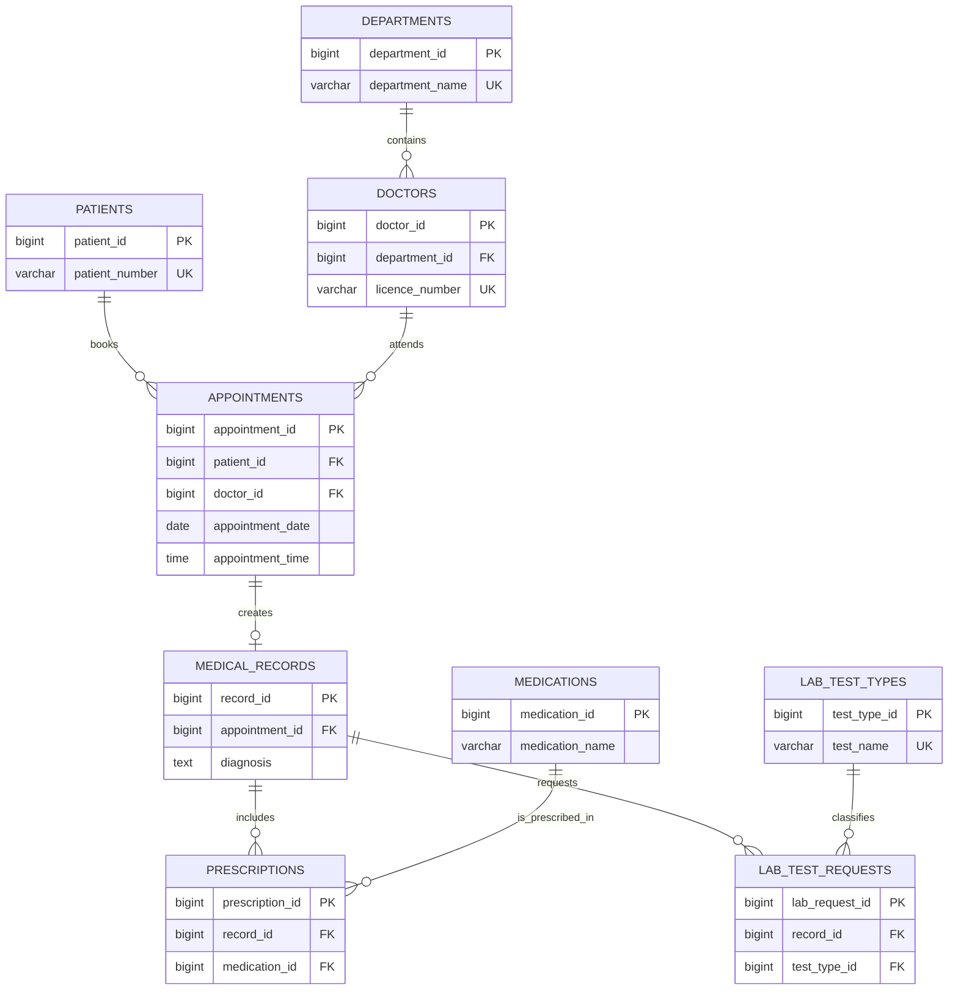

# Entity Relationship Diagram

## Reading the diagram

`||--o{` means **one-to-many**. For example, one patient can book many
appointments, but each appointment belongs to one patient. `||--o|` means
**one-to-zero-or-one**: an appointment may not yet have a medical record, but
when it does, that record belongs to only that appointment.
